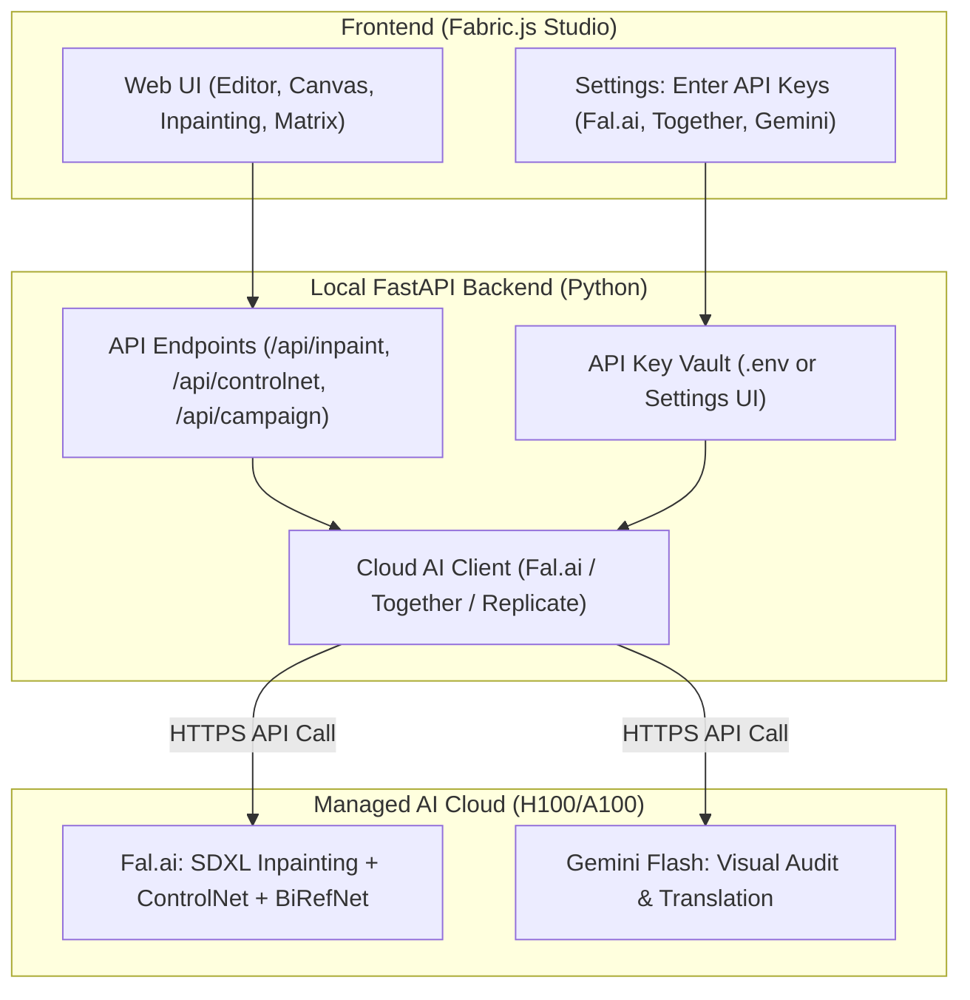

# Implementation Plan: Migration to Managed Cloud APIs (API Keys)

Transitioning VariantForge AI from a self-hosted Google Colab GPU worker (which suffers from session drops, Cloudflare tunnel timeouts, and VRAM limits) to **Managed Cloud AI APIs** using API keys.

---

## 1. Goal Description

Currently, VariantForge AI relies on:
1. Google Colab Tesla T4 GPU (free tier) running custom FastAPI & Uvicorn.
2. Cloudflare quick tunnels / Ngrok tunnels for remote exposure.

**Problems with Colab:**
- Free Colab disconnects every few hours or goes idle.
- Cloudflare tunnels timeout after 100 seconds (error 524).
- 16GB VRAM limit triggers `torch.OutOfMemoryError` when swapping between SDXL Inpainting, ControlNet, and Text2Image.
- You must manually start Colab cells and copy/paste URLs every session.

**The Solution:**
Replace the Colab worker entirely by integrating **cloud API providers**. With an API key, generations run reliably in 2–4 seconds on high-end hardware (NVIDIA A100 / H100) with 99.9% uptime, no Colab cells, no tunnels, and zero VRAM errors.

---

## 2. API Key Providers & Where to Get Them

Here is the breakdown of providers, the models they support, their free tiers, and links to get keys:

| AI Capability | Recommended Provider | Backup Provider | Free Tier / Pricing | Where to Get API Key |
| :--- | :--- | :--- | :--- | :--- |
| **SDXL Inpainting & Text2Image** | **Together AI** | **Fal.ai** / **Replicate** | **\$5 Free Credit** on signup (~2,500 SDXL generations free) | [together.ai](https://api.together.xyz/settings/api-keys) |
| **ControlNet Canny Guidance** | **Fal.ai** | **Replicate** | **\$10 Free Credit** on Fal.ai / Pay-per-second on Replicate | [fal.ai/dashboard/keys](https://fal.ai/dashboard/keys) or [replicate.com](https://replicate.com/account/api-tokens) |
| **Background Removal (RMBG / BiRefNet)** | **Fal.ai (birefnet)** | **Hugging Face Inference API** | **Free tier on HuggingFace**, fractions of a cent on Fal.ai | [fal.ai](https://fal.ai/models/fal-ai/birefnet) or [huggingface.co/settings/tokens](https://huggingface.co/settings/tokens) |
| **Visual Design Audit (Qwen2.5-VL / GPT-4o-mini)** | **Google Gemini 1.5 Flash** or **OpenAI** | **Together AI (Qwen 2.5 72B)** | **Free 15 RPM on Google AI Studio** (100% Free tier!) | [aistudio.google.com](https://aistudio.google.com/app/apikey) |
| **OCR Text Extraction** | Keep Local **EasyOCR** (runs fast even on CPU) | **Google Cloud Vision** | Local runs 100% free with no keys needed | Local Python package |

---

## 3. Recommended Provider Setup (Single / Dual Key Approach)

### Option A: The "Best Quality & Value" Stack (Recommended)
1. **Fal.ai (`FAL_KEY`)**:
   - Covers **SDXL Inpainting**, **ControlNet Canny**, **FLUX.1 Schnell**, and **BiRefNet / RMBG Background Removal** all in one single SDK (`pip install fal-client`).
   - Generates images in 1.2 to 2.5 seconds on H100 GPUs.
   - Cost: ~\$0.003 per image.
   - Where to get: Sign up at [https://fal.ai](https://fal.ai) $\rightarrow$ Dashboard $\rightarrow$ Keys.
2. **Google Gemini Flash (`GEMINI_API_KEY`)**:
   - Covers **Vision Design Audit** (replacing Qwen2.5-VL) and **Headline/CTA Translation & Reflow**.
   - Cost: **100% Free** up to 15 requests per minute at [https://aistudio.google.com](https://aistudio.google.com/app/apikey).

### Option B: The "Single Key" Replicate Stack
1. **Replicate (`REPLICATE_API_TOKEN`)**:
   - Covers SDXL, ControlNet, Inpainting, and Rembg under one provider.
   - Where to get: [https://replicate.com/account/api-tokens](https://replicate.com/account/api-tokens).

---

## 4. Architectural Changes to VariantForge AI



### Key Benefits:
- **No Colab Notebook to Run**: You never have to open Colab, run cells, or wait for 5GB model downloads.
- **No Cloudflare Tunnels**: No more tunnel disconnects, stale URLs, or error 524 timeouts.
- **Instant Speed**: SDXL & FLUX generate in 2–3 seconds on cloud H100 GPUs.
- **Never Out of Memory**: No more `torch.OutOfMemoryError`.

---

## 5. Proposed Code Modifications

### 1. `backend/app/config.py` & `.env`
- Add configuration settings:
  ```python
  FAL_KEY: Optional[str] = None
  TOGETHER_API_KEY: Optional[str] = None
  REPLICATE_API_TOKEN: Optional[str] = None
  GEMINI_API_KEY: Optional[str] = None
  ```

### 2. `backend/app/services/cloud_ai_service.py` [NEW]
- Centralized client routing requests to Fal.ai / Together / Replicate based on user keys.
- Fallback to local CPU execution if keys are not set.

### 3. Update Existing Pipeline Services:
- `inpainting_service.py` $\rightarrow$ calls `fal.subscribe("fal-ai/fast-sdxl/inpaint")`.
- `controlnet_service.py` $\rightarrow$ calls `fal.subscribe("fal-ai/controlnet-canny")`.
- `background_removal_service.py` $\rightarrow$ calls `fal.subscribe("fal-ai/birefnet")`.
- `image_generation_service.py` $\rightarrow$ calls `fal.subscribe("fal-ai/flux/schnell")`.

### 4. `frontend/public/index.html` & `app.js` (Settings Tab):
- Add API Key inputs directly into the **Settings** view so you can paste and save your key directly in the UI.

---

## 6. Verification Plan

1. **API Key Validation Test**:
   - Provide a test endpoint `POST /api/models/test-key` to test connectivity.
2. **Inpainting Test**:
   - Send mask + prompt to cloud provider, verify 200 OK and return image in < 4 seconds.
3. **ControlNet Test**:
   - Verify Canny generation runs without dimension or VRAM errors.
4. **Campaign Matrix Test**:
   - Verify 4 variations are produced simultaneously in parallel via cloud API.
