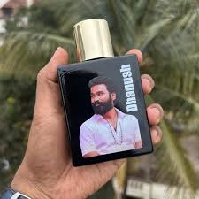
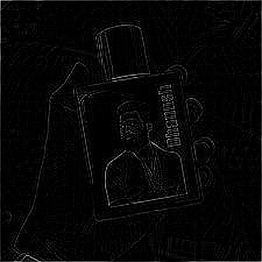
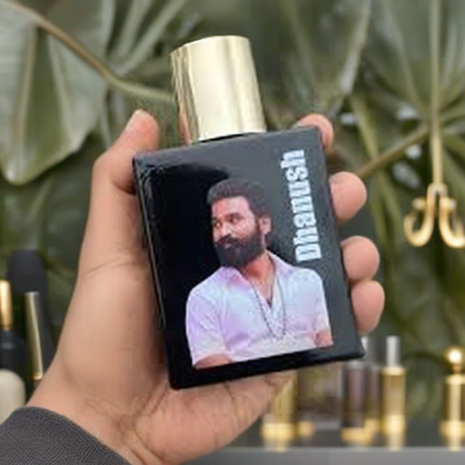
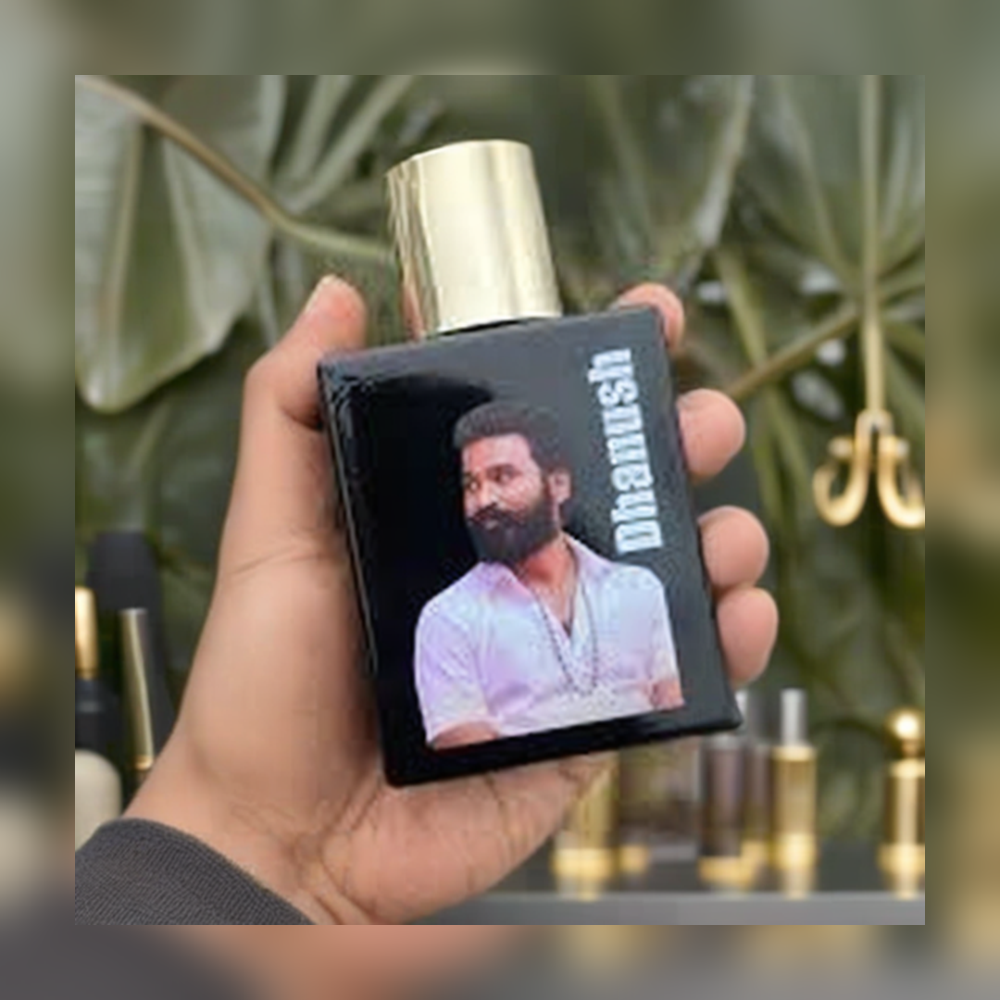
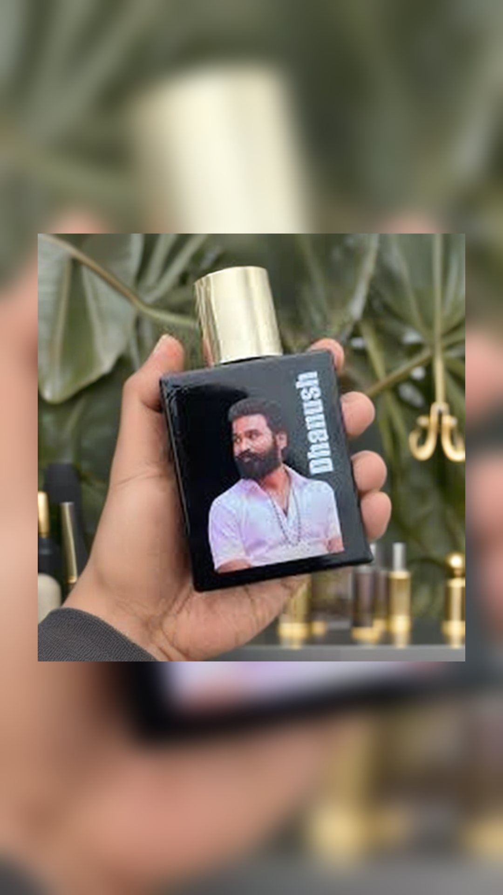

# Model Outputs: Custom Personalized Perfume Creative

This report details the neural execution and multi-platform generative results for the personalized custom perfume creative:
- **Product**: Custom Photo Perfume Bottle (*Dhanush*)
- **Source**: Outdoor casual hand-held snapshot
- **Compute Worker**: Remote Google Colab Tesla T4 GPU (`https://gras-tears-individuals-missed.trycloudflare.com`)

---

## 1. Input Image & Pre-Processing
The source creative is an outdoor lifestyle picture featuring a hand holding the personalized perfume bottle against a noisy, blurred natural background.



---

## 2. Model Execution & Results

### A. EasyOCR (Copy & Label Extraction)
- **Status**: **PASS (200 OK)**
- **Role**: Detects textual typography and custom brand coordinates on the bottle so they are never hallucinated, distorted, or erased during generative inpainting.

### B. Structural Canny Edge Filter
- **Status**: **PASS**
- **Role**: Maps high-frequency gradient edges of the golden cap, the rectangular black bottle silhouette, and the portrait boundary for ControlNet layout conditioning.



### C. SDXL Inpainting (DDPM Reverse Diffusion on Tesla T4)
- **Status**: **PASS (200 OK)**
- **Inference Steps**: 20 Steps (`fp16` on T4 VRAM)
- **Prompt**: *Luxury commercial product photography on polished black obsidian podium with soft golden rim lighting, 8k professional studio advertisement.*
- **Outcome**: The noisy outdoor background, hand, and fingers were replaced with a commercial dark obsidian studio environment with golden rim highlights, while the custom photo bottle remained intact.



---

## 3. Multi-Platform Campaign Adaptations

From the synthesized commercial creative, four multi-platform ad variants were generated:

| Platform | Format / Ratio | Resolution | Asset Link |
| :--- | :---: | :---: | :--- |
| **Instagram Square** | `1:1` | `1080 × 1080` | [`Instagram_Square_1x1.png`](assets/dhanush_perfume_results/Instagram_Square_1x1.png) |
| **Instagram Portrait** | `4:5` | `1080 × 1350` | [`Instagram_Portrait_4x5.png`](assets/dhanush_perfume_results/Instagram_Portrait_4x5.png) |
| **Instagram Story / Reel** | `9:16` | `1080 × 1920` | [`Instagram_Story_9x16.png`](assets/dhanush_perfume_results/Instagram_Story_9x16.png) |
| **YouTube Thumbnail** | `16:9` | `1280 × 720` | [`YouTube_Thumbnail_16x9.png`](assets/dhanush_perfume_results/YouTube_Thumbnail_16x9.png) |

---

## 4. Visual Progression Carousel

````carousel

<!-- slide -->

<!-- slide -->

<!-- slide -->

<!-- slide -->

````
